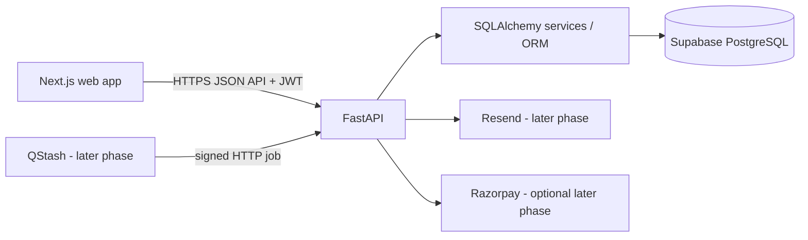

# Architecture

The application is a modular monolith: one Next.js frontend, one FastAPI backend and one PostgreSQL database.

Business rules live in backend services, not React components. PostgreSQL constraints and transactions protect important invariants. External integrations are optional adapters and must fail explicitly rather than fabricating success.
